# Лабораторная работа №1. Введение в Docker и базовые команды

## Задание 1.1. Установка и проверка Docker

Установлен Docker Desktop, проверены версии Docker и Docker Compose, запущен тестовый контейнер `hello-world`.

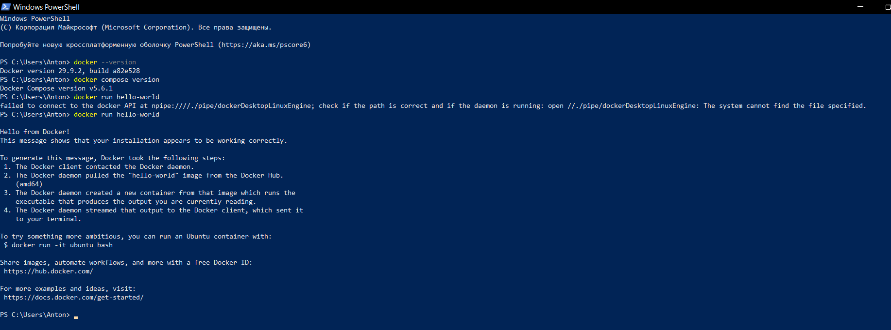

## Задание 1.2. Работа с образами

Скачаны образы `ubuntu`, `nginx`, `python` и `redis`, просмотрен их список и слои образа Ubuntu, удалён образ `redis`.

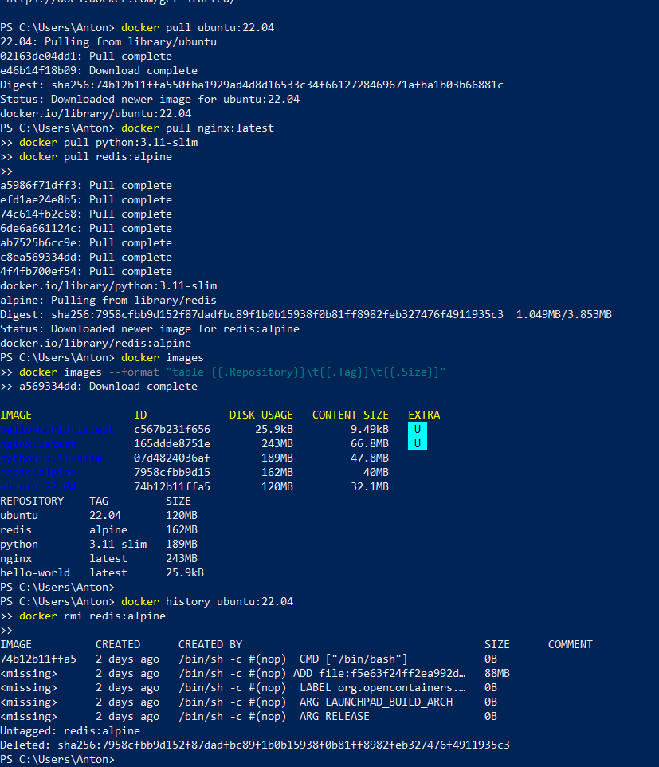

## Задание 1.3. Запуск и управление контейнерами

Запущен контейнер Ubuntu в интерактивном режиме и nginx в фоновом режиме, просмотрены логи, выполнено подключение к контейнеру, проверены остановка, запуск и перезапуск.

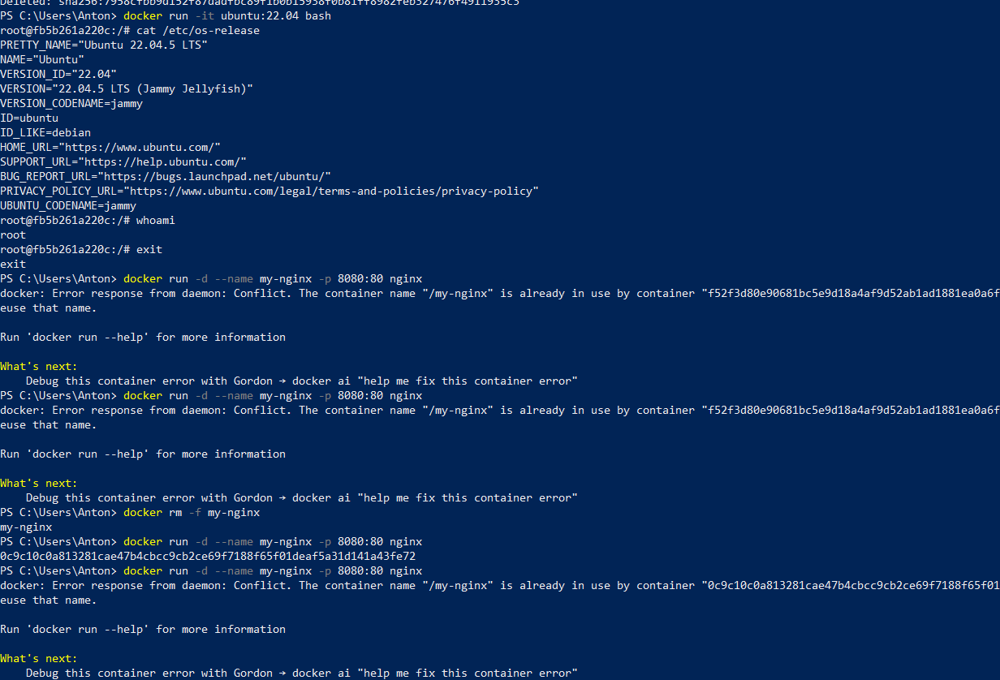

## Задание 1.4. Проброс портов

Проверена доступность nginx на порту 8080, запущен второй контейнер nginx на порту 8081, просмотрено соответствие портов.

## Задание 1.5. Очистка системы

Остановлены и удалены все контейнеры, удалены неиспользуемые образы.

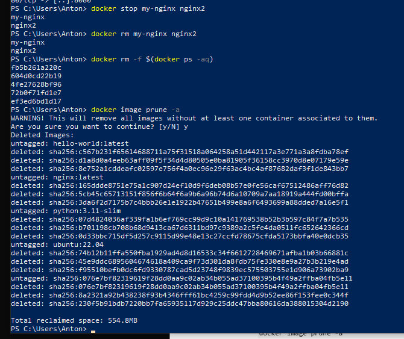

## Вывод

Docker установлен и настроен, изучены основные команды для работы с образами и контейнерами, проброс портов и очистка системы.

 Лабораторная работа №2. Создание Dockerfile и сборка образов

Файлы работы находятся в папке [`lab2`](lab2).

## Задание 2.1. Создание простого веб-приложения

Создано веб-приложение на Flask с двумя маршрутами: `/` возвращает приветствие, имя хоста и версию Python, `/health` возвращает статус приложения.

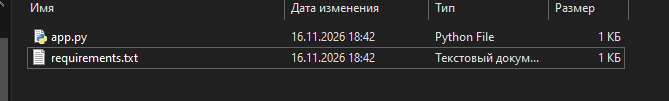

## Задание 2.2. Создание первого Dockerfile

Написан [Dockerfile](lab2/Dockerfile) на базе `python:3.11`, собран образ `myflask:v1`, запущен контейнер, проверен ответ приложения и логи.

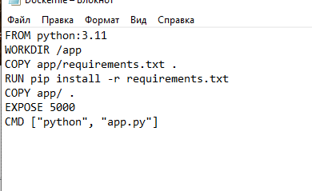

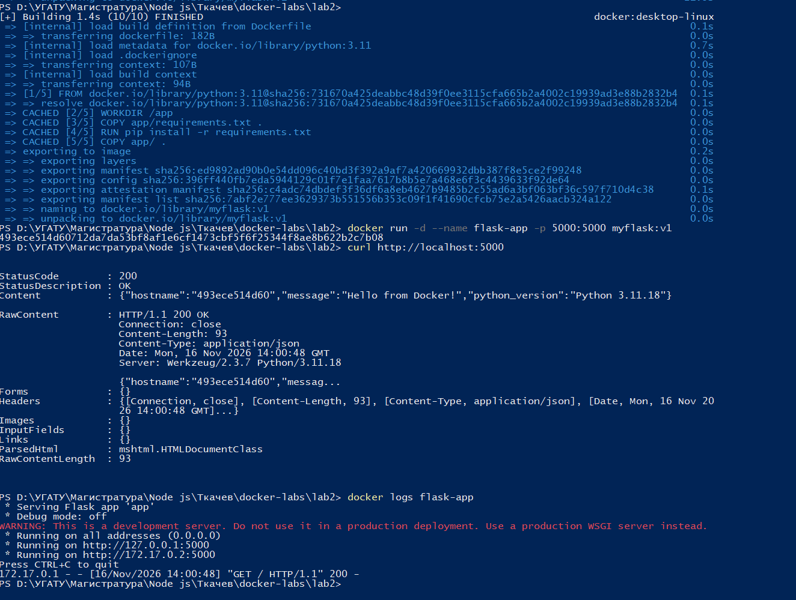

## Задание 2.3. Оптимизация Dockerfile

Написан [Dockerfile.optimized](lab2/Dockerfile.optimized): используется облегчённый образ `python:3.11-slim`, отключён кэш pip, приложение запускается от непривилегированного пользователя `appuser`. Размер образа заметно уменьшился по сравнению с `myflask:v1`.

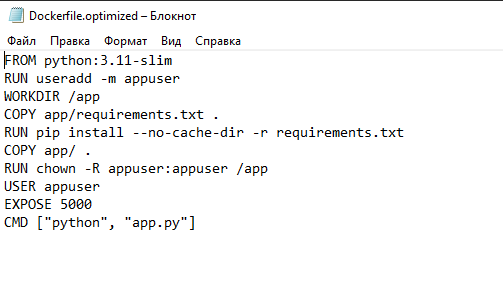

## Задание 2.4. Создание .dockerignore

Создан файл [.dockerignore](lab2/.dockerignore), который исключает из контекста сборки служебные файлы: кэш Python, виртуальное окружение, настройки редактора, логи и `.env`.

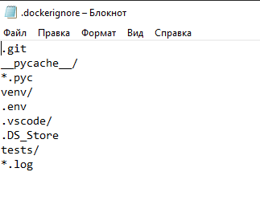

## Задание 2.5. Multi-stage сборка (Go)

Написан HTTP-сервер на Go и [Dockerfile](lab2/go-app/Dockerfile) с двумя стадиями: в первой программа компилируется в образе `golang`, во вторую (на базе `alpine`) копируется только готовый бинарный файл. Итоговый образ получился в разы меньше образа с компилятором.

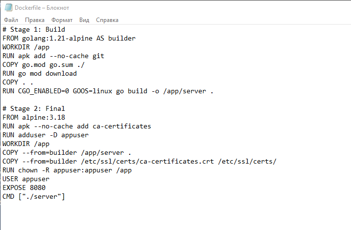

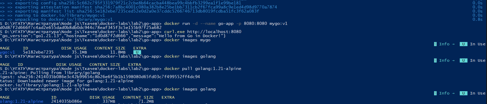

## Вывод

Изучено написание Dockerfile и концепция слоёв. Освоены способы уменьшения размера образа: облегчённые базовые образы, отключение кэша, `.dockerignore` и multi-stage сборка. Также настроен запуск приложений от непривилегированного пользователя.
