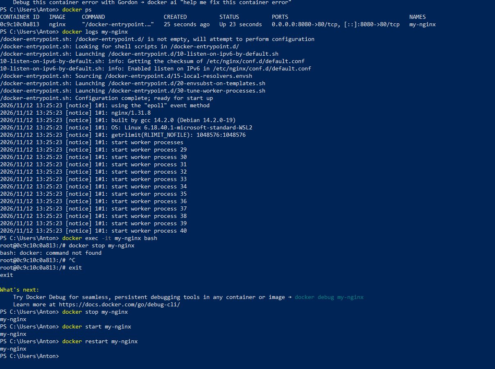
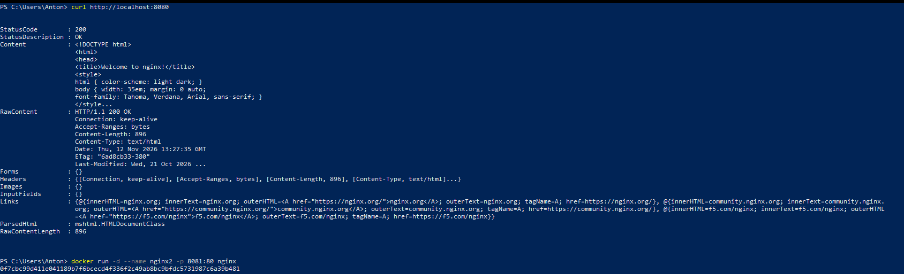
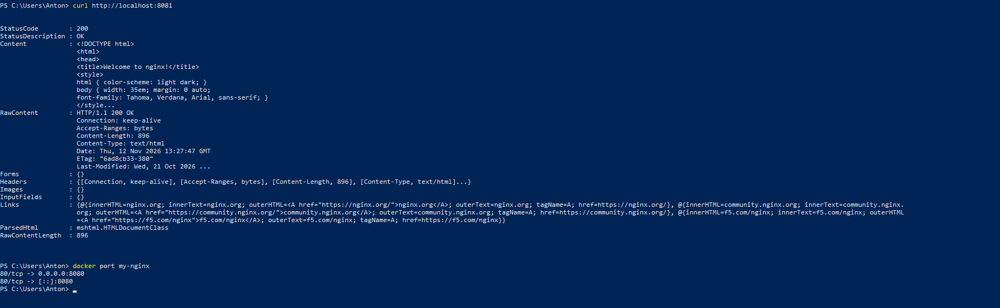

# Лабораторная работа №1. Введение в Docker и базовые команды

## Задание 1.1. Установка и проверка Docker

Установлен Docker Desktop, проверены версии Docker и Docker Compose, запущен тестовый контейнер `hello-world`.

## Задание 1.2. Работа с образами

Скачаны образы `ubuntu`, `nginx`, `python` и `redis`, просмотрен их список и слои образа Ubuntu, удалён образ `redis`.

## Задание 1.3. Запуск и управление контейнерами

Запущен контейнер Ubuntu в интерактивном режиме и nginx в фоновом режиме, просмотрены логи, выполнено подключение к контейнеру, проверены остановка, запуск и перезапуск.

## Задание 1.4. Проброс портов

Проверена доступность nginx на порту 8080, запущен второй контейнер nginx на порту 8081, просмотрено соответствие портов.

## Задание 1.5. Очистка системы

Остановлены и удалены все контейнеры, удалены неиспользуемые образы.

## Вывод

Docker установлен и настроен, изучены основные команды для работы с образами и контейнерами, проброс портов и очистка системы.
